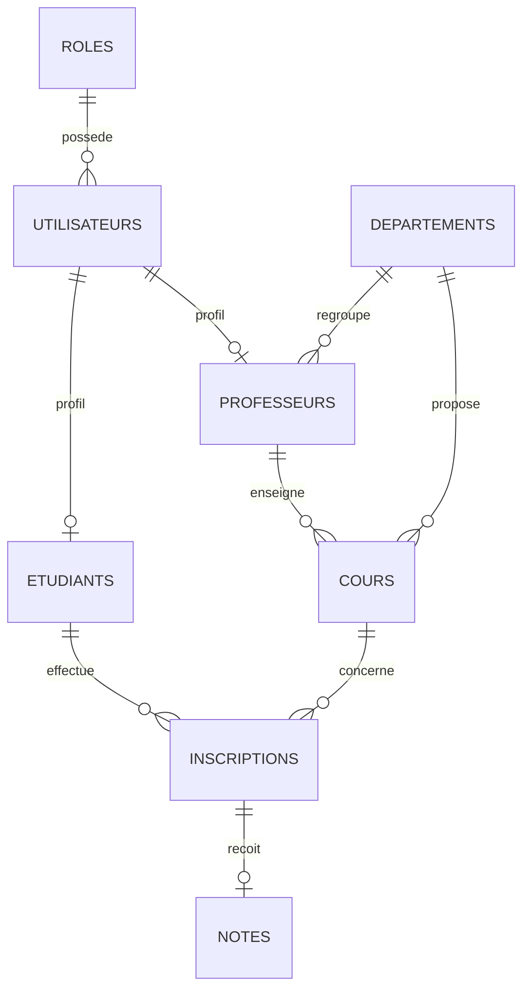

# Modèles conceptuel et physique — Gestion universitaire

## MCD (entités et cardinalités)

- ROLE (0,N) — possède — (1,1) UTILISATEUR
- UTILISATEUR (0,1) — possède le profil — (1,1) ETUDIANT
- UTILISATEUR (0,1) — possède le profil — (1,1) PROFESSEUR
- DEPARTEMENT (0,N) — regroupe — (1,1) PROFESSEUR
- DEPARTEMENT (0,N) — propose — (1,1) COURS
- PROFESSEUR (0,N) — enseigne — (1,1) COURS
- ETUDIANT (0,N) — effectue — (1,1) INSCRIPTION
- COURS (0,N) — reçoit — (1,1) INSCRIPTION
- INSCRIPTION (0,1) — reçoit — (1,1) NOTE

## MPD (tables, clés et contraintes)

| Table | Clé primaire | Clés étrangères / contraintes |
|---|---|---|
| roles | id | nom unique |
| utilisateurs | id | role_id → roles.id ; email unique |
| etudiants | id | utilisateur_id → utilisateurs.id unique ; matricule unique |
| professeurs | id | utilisateur_id → utilisateurs.id unique ; departement_id → departements.id |
| departements | id | nom unique |
| cours | id | professeur_id → professeurs.id ; departement_id → departements.id ; code unique |
| inscriptions | id | etudiant_id → etudiants.id ; cours_id → cours.id ; unicité (etudiant_id, cours_id) |
| notes | id | inscription_id → inscriptions.id unique ; note entre 0 et 100 |

## Diagramme Mermaid

## Hypothèses de conception à faire valider

1. Un compte utilisateur possède un seul rôle.
2. Un utilisateur peut avoir au plus un profil étudiant ou professeur.
3. Un étudiant ne peut être inscrit qu'une seule fois au même cours.
4. Une inscription porte au maximum une note finale.
5. La note est exprimée sur 100.
